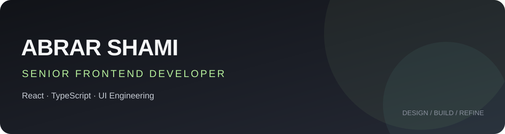

  

  <h3>Senior Frontend Developer · React & UI Engineering</h3>
  
Crafting responsive interfaces, thoughtful user experiences, and modern web applications.

  <a href="https://github.com/AbrarShami">GitHub</a> ·
  <a href="https://www.linkedin.com/in/abrar07/">LinkedIn</a> ·
  <a href="https://abrar-portfolio-pi.vercel.app/">Portfolio</a> ·
  <a href="mailto:abrar.shami@hotmail.com">Email</a>

---

## About

I'm a frontend developer focused on building clean, responsive, and reliable web experiences. I enjoy turning designs into polished interfaces, improving usability, and writing maintainable code.

- Frontend development with **React, JavaScript, and TypeScript**
- Modern UI development with **Next.js**
- Responsive styling with **CSS, SCSS, Tailwind CSS, and Bootstrap**
- Backend & Database with **Supabase, MongoDB**
- Cloud & Deployment with **AWS S3, Amazon CloudFront, AWS IAM, AWS Amplify Hosting, Vercel**
- Version Control & Collaboration with **Git, GitHub, Bitbucket, Jira, Confluence, Sourcetree**
- Experience across e-commerce Platforms: **Microsoft Dynamics 365 Commerce (UI/Frontend Development), Salesforce Commerce Cloud (SFRA)**
- Interested in accessibility, performance, design systems, and AI-assisted development

## Tech Stack

## Selected Projects

<table>
  <tr>
    <td width="50%">
      <h3><a href="https://perfume-store-jet.vercel.app/">ScentAura ↗</a></h3>
      
A production-minded Next.js App Router starter for a perfume store, designed to connect to Supabase.

    </td>
    <td width="50%">
      <h3><a href="https://ai-quote.vercel.app/">AI Quote Generator↗</a></h3>
      
This is a Next.js project bootstrapped with create-next-app.

    </td>
    </tr>
  <tr>
    <td width="50%">
      <h3><a href="https://next-js-ecom-admin-amber.vercel.app/">NextJs-EcomAdmin ↗</a></h3>
      
A production-minded Next.js App, designed to connect to MongDB.

    </td>
    <td width="50%">
      <h3><a href="https://ad-spark-apply.vercel.app/">Ad Spark ↗</a></h3>
      
A landing-page project focused on modern visual presentation and frontend layout.

    </td>
  </tr>
</table>

## Experience

**Ralph Lauren** · Frontend Developer  
SFRA storefront development, cart and checkout UI, responsive implementation.

**Movado** · UI Developer  
Storefront redesign, responsive UI, performance improvements, and A/B testing support.

**Dobbies Garden Centre** · Frontend Developer  
Frontend development work involving Microsoft Dynamics 365.

## Certifications

&nbsp;

## Let's Connect

  <a href="https://github.com/AbrarShami">GitHub</a> ·
  <a href="https://www.linkedin.com/in/abrar07/">LinkedIn</a> ·
  <a href="https://abrar-portfolio-pi.vercel.app/">Portfolio</a> ·
  <a href="mailto:abrar.shami@hotmail.com">Email</a>
    
  Designed with clarity. Built with curiosity.

